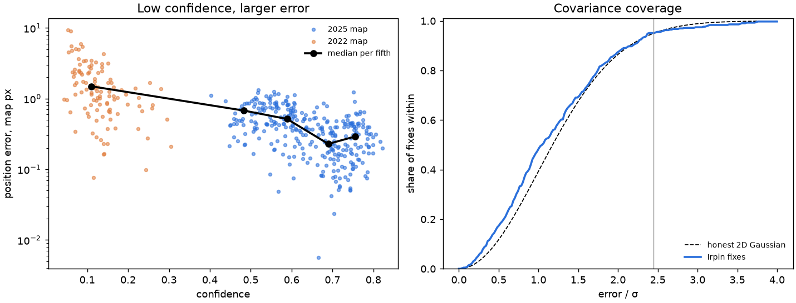

<p align="center">
  
</p>

# Orientyr

Visual navigation for a drone that has lost GNSS: each camera frame is matched to a satellite map to recover
the drone's position, heading and route. Built for the Spectron hackathon (IT-JIM task, advanced level).

> Work in progress. The full description of the approach, results and how to run it comes with M8-02.
> Contributors: start with [AGENTS.md](AGENTS.md) (workflow, tasks, data on the team Google Drive).

## Notes

### Frame-to-map scale (M1-03)

A drone frame usually shows the ground in finer detail than the map: 0.25 map px per frame px for the task
crops, about 0.5 for the Irpin flights (0.39 m/px frames, 0.76 m/px map). The map can't show detail finer
than its own pixels, so the extra frame pixels cost time without adding matches.

**Rule** ([src/dronenav/scale.py](src/dronenav/scale.py)): shrink the frame by `factor = scale / 0.65`,
clipped to [0.1, 1], so one shrunk frame pixel covers 0.65 map pixels. `scale` comes from the last accepted fix.
With no fix yet, factors 0.5, 0.25 and 1.0 are tried and the most inliers wins. Frames are never enlarged.
Matched points are mapped back to the original frame's pixels.

Measured with `python scripts/scale_table.py` (RootSIFT, MAGSAC++). "Localised" means within 10 px of the
truth. Error is the median distance of the frame centre from the truth, in map px. Ms is the median
resize + match time on an M-series Mac.

**Task crops** (50, matched to the whole 3645 × 1845 map):

| factor | localised | inliers (median) | error px (median) | ms (median) |
|---|---|---|---|---|
| 1.00 | 50/50 | 282 | 0.07 | 488 |
| 0.75 | 50/50 | 286 | 0.11 | 293 |
| 0.50 | 50/50 | 286 | 0.16 | 137 |
| 0.35 | 50/50 | 280 | 0.24 | 76 |
| 0.25 | 50/50 | 270 | 0.33 | 42 |
| rule (0.39) | 50/50 | 286 | 0.22 | 93 |

**Irpin, mild flight over the 2025 map** (50 keyframes, each matched to a 1600 px window around the truth,
so only the scale changes between rows):

| factor | localised | inliers (median) | error px (median) | ms (median) |
|---|---|---|---|---|
| 1.00 | 50/50 | 1962 | 0.42 | 736 |
| 0.75 | 50/50 | 1936 | 0.43 | 601 |
| 0.50 | 50/50 | 1709 | 0.41 | 465 |
| 0.35 | 50/50 | 1110 | 0.48 | 394 |
| 0.25 | 50/50 | 624 | 0.70 | 340 |
| rule (0.82) | 50/50 | 1896 | 0.42 | 649 |

What the tables show:
- Inliers stay flat until one shrunk frame pixel covers about one map pixel (task 0.25, Irpin 0.5), then
  drop fast. The rule's 0.65 stays on the safe side on both datasets.
- On the task crops the rule matches 5× faster than full resolution with the same inliers.
- On Irpin, about 300 ms of every match is map-side work (the FLANN index over the window's map features),
  whatever the frame size. Shrinking can't remove that; a smaller search window (M1-05) and the keypoint
  budget (M4-09) can.
- Every frame localises at every factor. With RootSIFT + FLANN, the downscale is a speed setting, not
  what makes the task crops work.

### Search strategy (M1-05)

[src/dronenav/search.py](src/dronenav/search.py) decides where on the map to look for each frame:
- **global:** the first frame, and the frame after a miss, search the whole map. With no scale known yet, the
  probe factors are tried.
- **window:** after a fix, the frame is matched only against the last footprint moved by the observed step,
  plus a margin of max(96 px, 25% of the footprint).
- **fallback:** if the window gives no accepted fix, the whole map is searched in the same frame.

Measured with `python scripts/search_run.py`. Frame 25 (task) and frame 200 (Irpin) were replaced by a black
frame as a forced miss:

| sequence | frames | global / window / fallback | error px (median / max) | ms window / global (median) | window size |
|---|---|---|---|---|---|
| Task crops | 50 | 2 / 47 / 1 | 0.21 / 0.51 | 71 / 903 | 2.6% of the map |
| Irpin mild 2025 keyframes | 442 | 2 / 439 / 1 | 0.43 / 1.19 | 383 / 1708 | 5.8% of the map |

Every frame after frame 0 is found in its window, except the forced miss. The miss falls back to the whole
map, finds nothing (correctly), and the next frame is found again by the global search.

### Per-fix confidence (M4-08)

[src/dronenav/confidence.py](src/dronenav/confidence.py) gives every accepted fix two numbers:
- **confidence** in [0, 1], for the trail colour, the HUD and plots. It is the product of three terms that
  saturate at 1: inliers `n/(n+100)`, inlier ratio `1.5r/(r+0.5)`, reprojection RMSE `9/(9+e²)`. No fix or a
  rejected one has confidence 0.
- **position σ**, the Kalman filter's measurement noise: `σ² = 0.2² + 3² e²/n + 0.75² ((1−r)/r)²` map px².
  The constants are a maximum-likelihood fit to the errors below, rounded.

Measured with `python scripts/confidence_check.py`: the four Irpin flights (first 80 keyframes each) against the
2025 map (320 of 320 accepted) and the cross-season 2022 map (110 of 320; the 2017 map gives none), with exact
truth:

| confidence fifth | 1 (lowest) | 2 | 3 | 4 | 5 (highest) |
|---|---|---|---|---|---|
| median error, px | 1.49 | 0.68 | 0.52 | 0.23 | 0.29 |
| p90 error, px | 4.44 | 1.13 | 0.88 | 0.52 | 0.53 |

The σ is honest: the truth is within 2 σ for 87.4% of the fixes (86.5% for a 2D Gaussian) and within 2.45 σ
for 95.1% (95%).



### Kalman filter (M5-01)

[src/dronenav/tracking/kalman.py](src/dronenav/tracking/kalman.py) tracks (x, y, vx, vy) in map px.
- It predicts to each frame's timestamp, gates each fix by its Mahalanobis distance (χ² 13.8, 99.9%), updates with
  the fix's own covariance (M4-08), and coasts when there is no fix.
- Measured on the Irpin truth at one fix per second, the image centre does not move smoothly: turns and camera
  sway put a one-second prediction 34 px (mild) to 70 px (harsh) away. The fixes are sub-pixel, so on this data the
  filter's job is to reject wrong matches and to bridge gaps, not to remove jitter.
- **Process noise:** a small value makes the filter gate good fixes, and it never recovers. The default
  `sigma_acc = 80` takes every true fix on all four flights. The predicted 95% circle holds the truth for 97%
  (harsh) to 100% (mild) of keyframes.
- **Noise model:** the prototype's piecewise-constant noise model (`Q = G Gᵀ σ²`) makes the velocity ring at that
  level: with 0.5 px fixes, its velocity error is 3.9 px/s and changes sign almost every frame. A continuous
  white-noise acceleration model is damped (0.96 px/s), and it is the one used.

### Offline smoother (M5-05)

[src/dronenav/tracking/smoother.py](src/dronenav/tracking/smoother.py) runs a Rauch–Tung–Striebel smoother back over
a finished run.
- **What it does:** each state is corrected by the fixes that came after it. A gap becomes an interpolation between
  the fixes on both sides, instead of a flight on the last velocity.
- **Labels:** every frame is marked `fix`, `interpolated` (a miss with a fix later) or `extrapolated` (a miss after
  the last fix).
- **Restarts:** a restart after LOST is a boundary, so two tracks are never blended.
- **Measured:** fixes with 3 px noise and 20% drops. RMS error, filtered → smoothed:

| flight | all frames | missed frames |
|---|---|---|
| simulated, 5 seeds (an 8-frame gap each) | 7.2–26.6 → 3.8–4.5 px | 13.4–54.4 → 5.4–7.1 px |
| Irpin mild, real motion | 25.4 → 11.1 px | 55.9 → 23.2 px |
| Irpin harsh, real motion | 55.8 → 21.8 px | 123.5 → 47.7 px |

### Accuracy (M1-10)

Every frame's position against the truth, measured with
[scripts/accuracy.py](scripts/accuracy.py) ([src/dronenav/accuracy.py](src/dronenav/accuracy.py)) on the
full pipeline (`scripts/run.py`'s localization: RootSIFT, the scale rule, the window search). The Irpin flights
carry exact truth from the renderer. The task crops are checked against `probe.json`, a full-resolution fit
(~0.2 px), so their numbers can't go below that.

- **Localized:** the frame got an accepted fix.
- **Wrong:** accepted, but more than 10 px from the truth. This is the dangerous kind: a miss leaves the route
  uncertain, while a wrong fix moves it with full confidence.
- **Error:** in map px; an Irpin map px is 0.76 m on the ground.
- **Ms:** the median search time per frame on an M-series Mac. A 2025 map has more features, so it is slower.

| sequence | map | frames | localized | wrong | error px median / p95 / max | ms |
|---|---|---|---|---|---|---|
| Task crops | task | 50 | 50 | 0 | 0.21 / 0.39 / 0.51 | 41 |
| Irpin mild 2025 | 2025 | 442 | 442 | 0 | 0.43 / 0.83 / 1.19 | 191 |
| Irpin mild 2022 | 2022 | 442 | 442 | 0 | 0.52 / 0.94 / 2.64 | 98 |
| Irpin mild 2017 | 2017 | 442 | 442 | 0 | 0.45 / 1.08 / 2.30 | 86 |
| Irpin mild, 30 m/s, 2025 | 2025 | 224 | 224 | 0 | 0.42 / 0.86 / 1.23 | 204 |
| Irpin mild, 30 m/s, 2022 | 2022 | 224 | 224 | 0 | 0.53 / 0.93 / 1.25 | 99 |
| Irpin mild, 30 m/s, 2017 | 2017 | 224 | 224 | 0 | 0.48 / 1.14 / 2.24 | 75 |
| Irpin harsh 2025 | 2025 | 280 | 280 | 0 | 0.58 / 1.30 / 1.83 | 227 |
| Irpin harsh 2022 | 2022 | 280 | 280 | 0 | 0.63 / 1.52 / 2.25 | 89 |
| Irpin harsh 2017 | 2017 | 280 | 280 | 0 | 0.77 / 1.50 / 2.43 | 70 |
| Irpin harsh, 30 m/s, 2025 | 2025 | 165 | 165 | 0 | 0.64 / 1.33 / 1.98 | 185 |
| Irpin harsh, 30 m/s, 2022 | 2022 | 165 | 165 | 0 | 0.68 / 1.75 / 2.28 | 88 |
| Irpin harsh, 30 m/s, 2017 | 2017 | 165 | 165 | 0 | 0.68 / 1.59 / 2.17 | 70 |
| **Stale map:** mild 2022 | 2025 | 442 | 146 | **3** | 1.04 / 6.08 / 16.45 | 114 |
| **Stale map:** mild 2017 | 2025 | 442 | 0 | 0 | none | |

What the table shows:
- On a map of the same year, every frame of every flight is found, with no wrong fix and a median error under
  1 px (under 0.6 m). Harsh flights cost a few tenths of a pixel more.
- The stale map is the open problem. Three years of change (2022 imagery on the 2025 map) leave a third of the
  frames found, and 3 of those are wrong. Eight years (2017) leave none. This is what the learned matchers (M4)
  and the filter (M5) are for.
- Up to ~0.7 px of each error may be the engine's half-pixel convention (#106): it depends on the heading.

Reproduce one row (`--truth` takes `truth.jsonl`, its flight folder or `probe.json`):

```bash
python scripts/accuracy.py --map data/irpin/maps/irpin_2025.png --frames data/irpin/flights/mild/2025/frames \
    --run outputs/acc/mild_2025 --truth data/irpin/flights/mild/2025
```

The regression tests are in [tests/test_accuracy.py](tests/test_accuracy.py):
- **CI:** the fixture's 3 Irpin keyframes must each stay within 1.5 px (measured 0.24 to 0.53).
- **Locally, with the data:** the 50 task crops and 40 consecutive Irpin keyframes must keep a median ≤ 0.5 px
  and a max ≤ 1.5 px, with no wrong fix.
