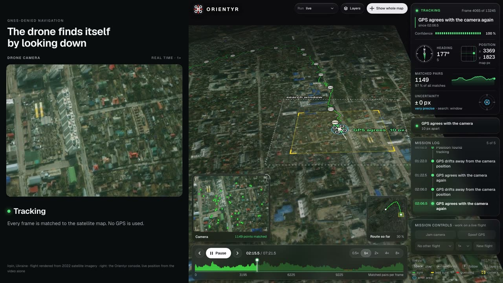
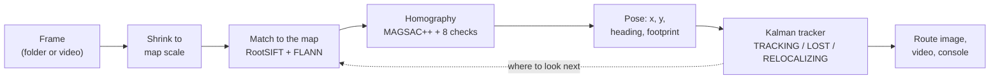
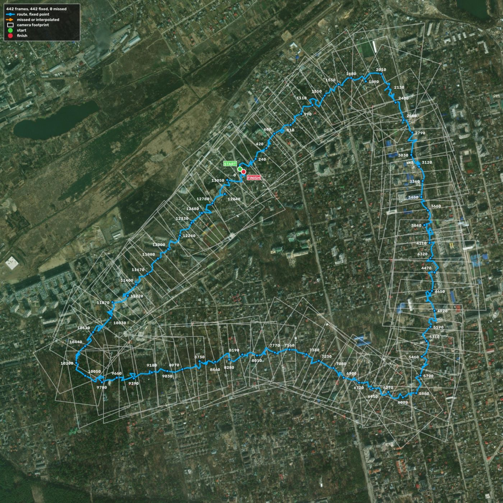

<p align="center">
  
</p>

# Orientyr

A drone has lost GPS. It still has a camera and a satellite map. Orientyr matches each camera frame to the map
and gets back the drone's position, heading and route.

Built for the Spectron hackathon (IT-JIM task, advanced level).

## Demo

[](results/demo/orientyr_demo.mp4)

Click the picture to watch the video (3 min 14 s): the console, a normal flight, a flight over forest, a jammed
camera and a GPS spoofing attack.

## Approach



Why these tools:

- **RootSIFT + FLANN.** The frames are rotated and have another scale than the map. SIFT features do not change
  with rotation or scale, and they need no GPU and no training. A second matcher, XFeat (a small neural network),
  sits behind the same interface for comparison: `--matcher xfeat`.
- **MAGSAC++ homography and 8 sanity checks.** A wrong position is worse than no position, so a doubtful match
  is rejected: too few inliers, mirrored, stretched, impossible perspective and so on.
- **Kalman filter with states.** It predicts where the drone is, so the next frame is matched only to a small
  window of the map. With no fix it keeps the last position and says how unsure it is.
- **GPS check.** The camera position is compared with the GPS. If they drift apart, the GPS is marked as spoofed.

Every step, with its measurements: [NOTES.md](NOTES.md).

## Install

You need **Python 3.11** or newer and `git`.

```bash
git clone https://github.com/kolyakr/orientyr.git
cd orientyr
python3 -m venv .venv
source .venv/bin/activate
pip install -r requirements.txt && pip install -e .
```

## Data

The data is not in git. It is in the team's Google Drive folder:
<https://drive.google.com/drive/folders/1Z5iIhFekHIFkAjH49jxUdf3k4SGw7voe>

Download the folder `hackatons-data` and unzip it so that `data/hackatons-data/global_map.png` exists. Or use
rclone:

```bash
tools/data.sh setup
tools/data.sh pull hackatons-data
```

The layout of all the data is in [data/README.md](data/README.md), its sources and licences in
[DATA_CARD.md](DATA_CARD.md).

## Run

One command reads the map and the frames and writes the route image and the video:

```bash
python scripts/run.py --map data/hackatons-data/global_map.png --frames data/hackatons-data/crops --out outputs/run1
```

```text
run: 50 of 50 frames localized in 13.2 s -> outputs/run1 (trajectory.png, trajectory.mp4)
```

A video works the same way, and `--jam` turns the camera off for a stretch of the flight to test recovery:

```bash
python scripts/run.py --map data/irpin/maps/irpin_2022.png --video data/irpin/flights/mild/2022/flight.mp4 --every 30 --out outputs/video
python scripts/run.py --map data/irpin/maps/irpin_2022.png --frames data/irpin/flights/mild/2022/frames --out outputs/jam --jam 150:30
```

## Outputs

| File | What it is |
|---|---|
| `trajectory.png` | the map at full size with the route, numbered points, START and FINISH |
| `trajectory_preview.jpg` | the same picture, 1600 px wide |
| `trajectory.mp4` | video with the drone's live position, the camera frame and a HUD |
| `run.jsonl` | one record per frame: state, position, heading, inliers, confidence |
| `run.json` | which map and which frames the run used |

## Result

A flight over Irpin, Ukraine, rendered from 2022 satellite imagery: 442 of 442 keyframes localized.



## Numbers

Measured against ground truth with [scripts/accuracy.py](scripts/accuracy.py). A wrong fix is an accepted
position more than 10 px from the truth.

| Sequence | Frames localized | Wrong fixes | Median error |
|---|---|---|---|
| Task data, 50 frames | 50 of 50 | 0 | 0.59 px |
| Irpin flight, 442 keyframes | 442 of 442 | 0 | 0.66 px (about 0.5 m) |

The two matchers on the same 60 frames (CPU):

| Matcher | Frames localized | Median error | Time per frame |
|---|---|---|---|
| RootSIFT (default) | 60 of 60 | 0.68 px | 262 ms |
| XFeat | 60 of 60 | 1.17 px | 155 ms |

Known limit: when the map is three years newer than what the drone sees, only a third of the frames are found.
All tables and how they were measured: [NOTES.md](NOTES.md#numbers).

## Tests

```bash
tools/task.sh test
```

About 1650 tests. They need no data and no network, and CI runs them on every pull request.

## Repo layout

```text
src/dronenav/   the package: matching, geometry, tracking, drawing
scripts/        command-line tools: run.py, render_video.py, accuracy.py, benchmark.py, live.py
tests/          the test suite
ui/             the console in the browser (Next.js), see ui/README.md
results/        small images and the demo video used on this page
```

## Console

The console from the demo replays any run folder and follows a live flight. It needs Node.js 20 or newer.

```bash
cd ui
npm install
npm run dev
```

Open <http://localhost:3000>. Details: [ui/README.md](ui/README.md). How the team works:
[CONTRIBUTING.md](CONTRIBUTING.md).
