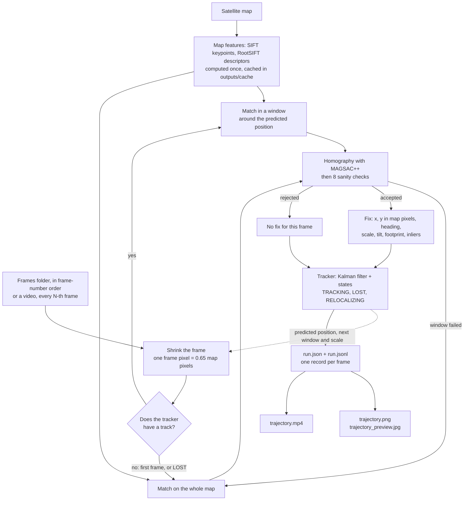
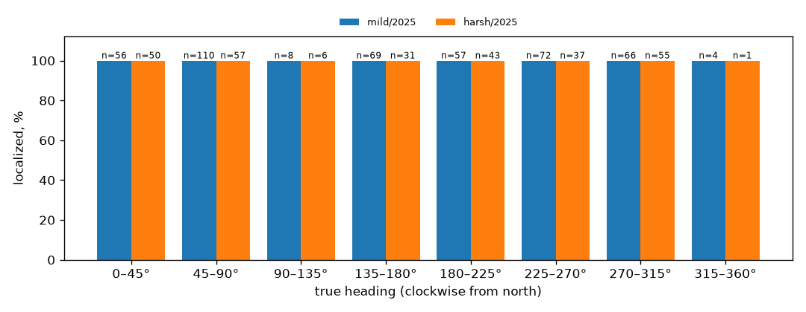

<p align="center">
  
</p>

# Orientyr

A drone has lost GPS. It still has a camera and a satellite map. Orientyr matches each camera frame to the map
and gets back the drone's position, heading and route.

Built for the Spectron hackathon (IT-JIM task, advanced level). The task gives one satellite map and 50 drone
frames in flight order. The frames are rotated and have a different scale than the map. The program must draw the
route on the map and make a video with the drone's position.

This is README v1. It describes what the code does today. Things that are not built yet are marked **planned**.
Contributors: the team workflow (tasks, branches, PRs) is in [AGENTS.md](AGENTS.md).

## Approach

Each frame goes through the same steps. A tracker keeps the drone's position and speed between frames. It tells
the next frame where to look on the map, and it decides when the track is lost.



The steps, with the file that does each one:

1. **Read** ([src/dronenav/io.py](src/dronenav/io.py), [src/dronenav/video.py](src/dronenav/video.py)). Frames
   are sorted by the last number in the file name, so `crop_2.png` comes before `crop_10.png`. A video is sampled
   every N-th frame. If the flight has a `meta.json` with a camera block, the lens distortion is removed first.
2. **Shrink** ([src/dronenav/scale.py](src/dronenav/scale.py)). A frame shows more detail than the map has. The
   extra pixels only cost time, so the frame is made smaller first. The scale comes from the last fix (an accepted
   position). With no fix yet, three sizes are tried and the one with the most inliers wins.
3. **Match** ([src/dronenav/matching/rootsift.py](src/dronenav/matching/rootsift.py)). SIFT keypoints with
   RootSIFT descriptors, FLANN nearest neighbours, Lowe's ratio test (0.8). The map's features are computed once
   and saved to disk. A second matcher, XFeat (a small neural network), is behind the same interface:
   `--matcher xfeat`.
4. **Search** ([src/dronenav/search.py](src/dronenav/search.py)). The first frame is matched to the whole map.
   After that, a frame is matched only to a window around the position the tracker predicts. The window is wide
   when the tracker is unsure and narrow when it is sure. If the window fails, the whole map is tried again in the
   same frame.
5. **Fit and check** ([src/dronenav/geometry.py](src/dronenav/geometry.py)). MAGSAC++ fits a homography (a
   3 × 3 matrix that maps frame pixels to map pixels). Eight checks reject a wrong one: degenerate, too few
   inliers (under 15), not convex, mirrored, scale out of range, stretched, impossible perspective, high
   reprojection error.
6. **Pose.** The frame centre on the map is the position. The rotation gives the heading. The four warped corners
   give the footprint (the ground the camera sees). The homography also gives the camera's tilt.
7. **Track** ([src/dronenav/tracking/kalman.py](src/dronenav/tracking/kalman.py),
   [src/dronenav/tracking/states.py](src/dronenav/tracking/states.py)). A Kalman filter keeps position and
   speed. It refuses a fix that is too far from its prediction, and it coasts (flies on with the last speed) when
   there is no fix. Every frame gets a state: `TRACKING`, `LOST` (after 3 misses in a row) or `RELOCALIZING` (a
   fix after a loss, waiting for a second fix that agrees).
8. **Draw** ([src/dronenav/viz/](src/dronenav/viz)). The route image and the video are drawn from the run
   folder, so they can be drawn again without matching again.

### Built, and planned

| Part | Status |
|---|---|
| Frames from a folder or a video, RootSIFT matcher, scale rule, window search, homography checks, Kalman tracker with states, route image, video | built, used by `scripts/run.py` |
| XFeat matcher ([src/dronenav/matching/xfeat.py](src/dronenav/matching/xfeat.py)) | built, `scripts/run.py --matcher xfeat`. RootSIFT stays the default |
| Per-fix confidence ([src/dronenav/confidence.py](src/dronenav/confidence.py)) | built, used by the tracker and the HUD video |
| Accuracy against ground truth ([scripts/accuracy.py](scripts/accuracy.py)) | built, see [Numbers](#numbers) |
| HUD ("mission control") video ([src/dronenav/viz/hud_video.py](src/dronenav/viz/hud_video.py)) | built, a second step: `scripts/render_video.py` |
| Console in the browser ([ui/](ui)) | built, replays a run folder, see [Console](#console) |
| Frame preprocessing, CLAHE ([src/dronenav/preprocess.py](src/dronenav/preprocess.py)) | built and measured, not used by `scripts/run.py` yet |
| Offline smoother and gap interpolation ([src/dronenav/tracking/smoother.py](src/dronenav/tracking/smoother.py), [src/dronenav/smoothing.py](src/dronenav/smoothing.py)) | built and tested, not used by `scripts/run.py` yet |
| GPS spoof detector | built as a separate script, `scripts/spoof_check.py`, see [Notes](#notes) |
| MAVLink `GPS_INPUT` output | a stub, not flight-tested: `scripts/mavlink_log.py`, see [Notes](#notes) |
| SuperPoint + LightGlue matcher | **planned**. The `lightglue` package is installed for this step |
| Our own phone video filmed over the map (advanced level) | `scripts/run.py --video` is built. The take itself is **planned**: it is not filmed yet |

## Install

You need:

- **Python 3.11** or newer (tested on 3.13 on macOS and on 3.11 in Linux CI);
- `git` (one package is installed from GitHub);
- about 1.5 GB of free disk space on macOS: the virtual environment is 1.3 GB, most of it `torch`. On Linux with
  the CUDA build of `torch` it is several GB (see below for the small CPU build).

You do not need to install ffmpeg. The video encoder comes with the `imageio-ffmpeg` package.

```bash
git clone https://github.com/kolyakr/orientyr.git
cd orientyr
python3 -m venv .venv
source .venv/bin/activate
pip install --upgrade pip
pip install -r requirements.txt && pip install -e .
```

The second `pip install` adds the `dronenav` package itself (the code in `src/`). Without it the scripts cannot
import `dronenav`.

On Linux without a GPU, set this before `pip install`. It takes the small CPU build of `torch` instead of the
2 GB CUDA build:

```bash
export PIP_EXTRA_INDEX_URL=https://download.pytorch.org/whl/cpu
```

Every time you open a new terminal, run `source .venv/bin/activate` again. The commands below were run on macOS
and Linux. On Windows use WSL, because the tools in `tools/` are bash scripts.

Check the install without any data. This makes a fake run folder (no matching) over a small map crop that is in the repo, and
draws its route:

```bash
python scripts/fake_run.py --map tests/fixtures/irpin_mild_2025/map_crop.jpg --out outputs/fake
python scripts/render_image.py --run outputs/fake
```

## Getting the data

The data is not in git. It lives in the team's Google Drive folder:
<https://drive.google.com/drive/folders/1Z5iIhFekHIFkAjH49jxUdf3k4SGw7voe>

For the task run you need only `hackatons-data/`: the map and the 50 frames (about 56 MB). The folder must look
like this:

```text
data/
  hackatons-data/
    global_map.png
    crops/crop_0.png ... crop_49.png
```

**Way 1, no extra tools.** Open the link in a browser. Download the folder `hackatons-data` (Google gives you a
zip). Unzip it so that the file `data/hackatons-data/global_map.png` exists.

**Way 2, with rclone.** Good when you want all the data, or want to update it later.

```bash
brew install rclone
tools/data.sh setup
tools/data.sh pull hackatons-data
```

`tools/data.sh setup` opens a browser once to log in to Google. `tools/data.sh pull` without a path downloads
everything, including our own Irpin data (several GB). `tools/data.sh pull irpin/maps` and
`tools/data.sh pull irpin/flights/mild/2022` get only what the Irpin examples below use. On Linux, install rclone
from <https://rclone.org/install/>.

Check the result:

```bash
python scripts/check_data.py
```

This checks the whole layout, described in [data/README.md](data/README.md). If you downloaded only
`hackatons-data`, it lists the `irpin/...` files as missing. That is fine for the task run. No line may start with
`missing: hackatons-data`.

## Run

One command does everything:

```bash
python scripts/run.py --map data/hackatons-data/global_map.png --frames data/hackatons-data/crops --out outputs/run1
```

It prints one line at the end:

```text
run: 50 of 50 frames localized in 13.2 s -> outputs/run1 (trajectory.png, trajectory.mp4)
```

The first run on a map computes the map's features and saves them in `outputs/cache` (about 75 MB for the task
map). Later runs on the same map load them.

Your own data works the same way: `--map` is any map image, `--frames` is a folder of images with numbers in
their names. More examples:

```bash
python scripts/run.py --map data/irpin/maps/irpin_2022.png --frames data/irpin/flights/mild/2022/frames --out outputs/irpin
python scripts/run.py --map data/irpin/maps/irpin_2022.png --video data/irpin/flights/mild/2022/flight.mp4 --every 30 --out outputs/video
python scripts/run.py --map data/irpin/maps/irpin_2022.png --frames data/irpin/flights/mild/2022/frames --out outputs/jam --jam 150:30
python scripts/run.py --help
```

- `--video` reads a video file instead of a folder. `--every 30` takes every 30th frame. Without `--every`, about
  3 frames per second of video are taken. The sampled frames are saved in `frames/` in the run folder.
- `--jam 150:30` is a stress test: from second 150 of the flight the camera is jammed for 30 seconds (the engine
  gets noise). The run shows the track lost and found again.
- `--matcher xfeat` uses the XFeat matcher. It downloads its weights (about 6 MB) on the first run.
- `--tracker none` turns the Kalman tracker off and keeps the raw fixes.
- `--fps` says how the numbers in the frame names become seconds (time = number / fps). The default comes from
  `meta.json` next to the frames, else 1.
- `--speed 5` makes the video five times faster than the flight. `--cache` moves the feature cache.

Exit code 0 means success. Code 1 means that no frame was found on the map (wrong map?). Code 2 means a bad path
or option. On an error, the output folder stays as it was.

## Outputs

`outputs/run1` gets five files:

| File | What it is |
|---|---|
| `trajectory.png` | The map at full size with the route, numbered points, footprints, START and FINISH |
| `trajectory_preview.jpg` | The same picture, 1600 px wide, easy to open and share |
| `trajectory.mp4` | Video (1280 × 720, H.264): a camera follows the drone over the map, with the trail, the footprint, the frame the drone saw, and a HUD (frame number, time, inliers, state) |
| `run.jsonl` | One line of JSON per frame: state, filtered position and speed, the fix (homography, heading, scale, footprint, inliers), time spent |
| `run.json` | Which map and which frames the run used |

A run from a video, or with `--jam`, also gets a folder `frames/` with the frames the engine saw.

`run.json` and `run.jsonl` point to the map and the frames by relative path. Do not move the run folder or the
data if you want to draw the image or the video again.

To draw again without matching again:

```bash
python scripts/render_image.py --run outputs/run1
python scripts/render_video.py --run outputs/run1 --out outputs/run1_hud --speed 5
python scripts/render_video.py --run outputs/run1 --style classic
```

`scripts/render_video.py` draws the HUD video by default: the "mission control" screen with the trail coloured
by confidence, match lines, a side panel and a timeline (see [HUD video](#hud-video-m7-02)). `--style classic` is
the plain video that `scripts/run.py` writes. Without `--out`, the new `trajectory.mp4` replaces the one in the
run folder.

Everything in `outputs/` is ignored by git.

## Result

Our own showcase flight: a simulated drone flight over Irpin, Ukraine, rendered from satellite imagery of 2022
(7 min 22 s of video, one keyframe per second). The engine localized 442 of 442 keyframes in 205 s on an
Apple M5 laptop. Blue line: the route. White boxes: what the camera saw. Numbers: frame numbers in the video.


This is `trajectory_preview.jpg` of the first Irpin command in [Run](#run), made smaller for the README.

## Numbers

### Accuracy (from M1-10)

How far each position is from the ground truth, measured with [scripts/accuracy.py](scripts/accuracy.py). The
Irpin flights have exact truth from the renderer. The task crops are checked against `probe.json`, a careful
full-resolution fit that is in the repo.

- **Localized:** the frame got an accepted fix.
- **Wrong:** accepted, but more than 10 px from the truth.
- **Error:** in map pixels. One Irpin map pixel is 0.76 m on the ground.

Measured again for this README on today's code (21 Nov 2026, Apple M5 laptop, Python 3.13):

| sequence | map | frames | localized | wrong | error px median / p95 / max |
|---|---|---|---|---|---|
| Task crops | task | 50 | 50 | 0 | 0.59 / 0.79 / 0.92 |
| Irpin mild 2022 | 2022 | 442 | 442 | 0 | 0.66 / 0.79 / 0.87 |

The task row needs one remark. `probe.json` uses another pixel convention than the engine does since M1-12 (pixel
centres against pixel corners), so about 0.5 px of every task error is a constant offset between the two, not a
real error. With the offset taken out, the scatter is 0.25 px median and 0.47 px max
([tests/test_accuracy.py](tests/test_accuracy.py)).

```bash
python scripts/accuracy.py --run outputs/run1 --truth experiments/data_probe/results/probe.json
python scripts/accuracy.py --run outputs/irpin --truth data/irpin/flights/mild/2022
```

The full M1-10 table (four flights, three map years, and the stale-map problem) is in the note
[Accuracy (M1-10)](#accuracy-m1-10). It was recorded on 21 Nov 2026 before M1-12 and is quoted there as it was
recorded. In short: on a map of the same year, every frame of every flight was found, with no wrong fix and a
median error under 1 px (under 0.6 m). On a map three years newer than the imagery, only a third of the frames
were found.

### Speed

The command in [Run](#run) on the task data. One run each on an Apple M5 laptop, Python 3.13. This is a smoke
check, not a benchmark.

| What | Value |
|---|---|
| Frames localized | 50 of 50 |
| Frames in state `LOST` | 0 |
| Whole command, first run (map features computed) | 13.2 s |
| Whole command, second run (map features from the cache) | 13.5 s |
| Matching only, per frame (median) | 68 ms |
| Matching only, first frame (whole map, three sizes tried) | 1.1 s |
| Search used | whole map: 1 frame, window: 49 frames |
| Inliers per frame | median 293, lowest 129 |

Most of the time is drawing the image and the video, not matching.

Measurements of single parts (the scale rule, the search, the confidence, the tracker, XFeat) are in the
[notes](#notes) at the end.

## Tests

```bash
tools/task.sh test
tools/task.sh test --full
ruff check .
```

`tools/task.sh test` runs pytest on `tests/` with the right import path, in parallel. It needs no data and no
network, runs on the CPU, and takes one and a half to three and a half minutes on a laptop (about 1650 tests; between
80 s and 204 s in four runs on an Apple M5). `--full` adds the tests that need the full dataset. They are skipped when `data/` is not there.
`ruff check .` is the linter. CI runs the fast suite and the linter on every pull request.

To run one file: `tools/task.sh test tests/test_geometry.py`.

## Repo layout

```text
src/dronenav/        the package
  io.py, video.py      frames from a folder or a video, the map
  camera.py            lens undistortion
  scale.py             how much to shrink a frame
  matching/            RootSIFT and XFeat matchers
  search.py            window or whole map
  geometry.py          homography, checks, pose
  confidence.py        how sure a fix is
  tracking/            Kalman filter, tracker states, offline smoother, GPS spoof detector
  pipeline.py          the steps wired together, the run folder
  telemetry.py         run.json and run.jsonl
  accuracy.py          error against ground truth
  viz/                 route image, plain video, HUD video
  preprocess.py, smoothing.py    built, not used by run.py yet
  mavlink.py, georef.py          fixes as MAVLink GPS_INPUT messages (a stub)
  sim/                 synthetic flights and "chaos" (blur, noise, dropped frames) for tests
scripts/             command-line tools: run.py, render_image.py, render_video.py, accuracy.py, check_data.py, ...
tools/               data.sh (data from the Drive), task.sh (team workflow and tests)
tests/               the test suite, with small fixtures in tests/fixtures/
ui/                  the console: a Next.js app that replays a run folder
results/             small curated images used in this README
experiments/         one-off research scripts, kept for the record
data/                the data (not in git)
outputs/             what the scripts write (not in git)
```

## Console

A "mission control" console in the browser replays a run folder: the map, the route coloured by confidence, the
camera frame, the tracker state and a mission log. It is a Next.js app in `ui/` and needs Node.js 20 or newer.
Details: [ui/README.md](ui/README.md).

```bash
cd ui
npm install
npm run dev
```

Open <http://localhost:3000>. It lists every run folder in `outputs/`. Pick one in the **Run** list at the top of
the map, or open `http://localhost:3000/?run=run1`.

## Notes

Measurements of single parts, each made when that part was built.

### Frame-to-map scale (M1-03)

A drone frame usually shows the ground in finer detail than the map: 0.25 map px per frame px for the task
crops, about 0.5 for the Irpin flights (0.39 m/px frames, 0.76 m/px map). The map can't show detail finer
than its own pixels, so the extra frame pixels cost time without adding matches.

**Rule** ([src/dronenav/scale.py](src/dronenav/scale.py)): shrink the frame by `factor = scale / 0.65`,
clipped to [0.1, 1], so one shrunk frame pixel covers 0.65 map pixels. `scale` comes from the last accepted fix.
With no fix yet, factors 0.5, 0.25 and 1.0 are tried and the most inliers wins. Frames are never enlarged.
Matched points are mapped back to the original frame's pixels.

Measured with `python scripts/scale_table.py` (RootSIFT, MAGSAC++). "Localised" means within 10 px of the
truth. Error is the median distance of the frame centre from the truth, in map px. Ms is the median
resize + match time on an M-series Mac.

**Task crops** (50, matched to the whole 3645 × 1845 map):

| factor | localised | inliers (median) | error px (median) | ms (median) |
|---|---|---|---|---|
| 1.00 | 50/50 | 282 | 0.07 | 488 |
| 0.75 | 50/50 | 286 | 0.11 | 293 |
| 0.50 | 50/50 | 286 | 0.16 | 137 |
| 0.35 | 50/50 | 280 | 0.24 | 76 |
| 0.25 | 50/50 | 270 | 0.33 | 42 |
| rule (0.39) | 50/50 | 286 | 0.22 | 93 |

**Irpin, mild flight over the 2025 map** (50 keyframes, each matched to a 1600 px window around the truth,
so only the scale changes between rows):

| factor | localised | inliers (median) | error px (median) | ms (median) |
|---|---|---|---|---|
| 1.00 | 50/50 | 1962 | 0.42 | 736 |
| 0.75 | 50/50 | 1936 | 0.43 | 601 |
| 0.50 | 50/50 | 1709 | 0.41 | 465 |
| 0.35 | 50/50 | 1110 | 0.48 | 394 |
| 0.25 | 50/50 | 624 | 0.70 | 340 |
| rule (0.82) | 50/50 | 1896 | 0.42 | 649 |

What the tables show:
- Inliers stay flat until one shrunk frame pixel covers about one map pixel (task 0.25, Irpin 0.5), then
  drop fast. The rule's 0.65 stays on the safe side on both datasets.
- On the task crops the rule matches 5× faster than full resolution with the same inliers.
- On Irpin, about 300 ms of every match is map-side work (the FLANN index over the window's map features),
  whatever the frame size. Shrinking can't remove that; a smaller search window (M1-05) and the keypoint
  budget (M4-09) can.
- Every frame localises at every factor. With RootSIFT + FLANN, the downscale is a speed setting, not
  what makes the task crops work.

### Search strategy (M1-05)

[src/dronenav/search.py](src/dronenav/search.py) decides where on the map to look for each frame:
- **global:** the first frame, and the frame after a miss, search the whole map. With no scale known yet, the
  probe factors are tried.
- **window:** after a fix, the frame is matched only against the last footprint moved by the observed step,
  plus a margin of max(96 px, 25% of the footprint).
- **fallback:** if the window gives no accepted fix, the whole map is searched in the same frame.

Measured with `python scripts/search_run.py`. Frame 25 (task) and frame 200 (Irpin) were replaced by a black
frame as a forced miss:

| sequence | frames | global / window / fallback | error px (median / max) | ms window / global (median) | window size |
|---|---|---|---|---|---|
| Task crops | 50 | 2 / 47 / 1 | 0.21 / 0.51 | 71 / 903 | 2.6% of the map |
| Irpin mild 2025 keyframes | 442 | 2 / 439 / 1 | 0.43 / 1.19 | 383 / 1708 | 5.8% of the map |

Every frame after frame 0 is found in its window, except the forced miss. The miss falls back to the whole
map, finds nothing (correctly), and the next frame is found again by the global search.

### Any heading (M2-05)

A drone can face any way, so a frame can be turned any amount against the north-up map. RootSIFT gives each
keypoint its own orientation, so the matcher needs no heading. [src/dronenav/rotation.py](src/dronenav/rotation.py)
measures that instead of trusting it: each frame goes through the same search the pipeline uses, and the results
are grouped by the frame's true heading, so a matcher that fails only when the drone flies south shows up as one
bad bin. A fix counts as localized if it is accepted and within 10 px of the truth, and as wrong if it is accepted
and further off.

Measured with `python scripts/rotation_check.py`: the Irpin flights turn through every heading.

| flight | frames | localized | wrong | median error px, per 45° bin | max heading error |
|---|---|---|---|---|---|
| mild 2025 | 442 | 442, all 8 bins at 100% | 0 | 0.26 – 0.55 | 0.30° |
| harsh 2025 | 280 | 280, all 8 bins at 100% | 0 | 0.42 – 0.68 | 0.43° |

The bins are uneven (the flights spend little time heading 90–135° and 315–360°: 1 to 8 frames each), but each has
frames. The tests add a synthetic full turn in 15° steps and real keyframes turned by 90°, 180° and 270°. The 360°
phone take re-checks this once it is filmed. The learned matchers (M4) are not rotation-invariant; M4-04 uses this
same report to show what turning the frame north-up by the compass gives them.



### Tilted camera and lens (M2-04)

A real camera is not looking straight down: the Irpin flights pitch 10–15° and roll up to 8°, so a frame lands
on the map as a trapezoid, not a rectangle. [src/dronenav/geometry.py](src/dronenav/geometry.py) reads the tilt
off the homography without knowing the camera: at the image centre the two stretches differ by exactly cos(tilt),
and the projective row then gives the focal length and the point under the drone (`nadir_point`). That point is
not `Fix.x, y` (where the image centre lands): with tilt they are altitude × tan(tilt) apart, 50–80 m here. Each
accepted fix reports its tilt as `tilt_deg` in run.jsonl's `extra`.

The check that follows from it: a centred pinhole camera can only make perspective along its tilt, and at most
as much as tan(tilt) / focal allows for the widest lens we accept (150°). Perspective across the tilt, or more of
it than the tilt explains, is a broken fit and is rejected with the reason `perspective`. Mirrored, horizon-in-frame
and over-stretched homographies keep their M1 reasons.

A lens also bends straight lines, and a homography only holds between pinhole images. When the flight's
meta.json has a `camera` block (K, dist, size), [src/dronenav/camera.py](src/dronenav/camera.py) undistorts each
frame as it is read. Measured on 80 SIFT fixes of the mild 2025 flight against its truth:

| frames | accepted | perspective across the tilt, max | tilt error, median / max | position error, max |
|---|---|---|---|---|
| raw | 80/80 | 0.082 | 1.14° / 3.71° | 1.36 px |
| undistorted | 80/80 | 0.005 | 0.05° / 0.61° | 0.87 px |

The tolerance (`perspective_tol` = 0.15, as a fraction of depth change from centre to corner) sits above what
raw lens distortion produces and well below broken fits (0.37 and up).

### Per-fix confidence (M4-08)

[src/dronenav/confidence.py](src/dronenav/confidence.py) gives every accepted fix two numbers:
- **confidence** in [0, 1], for the trail colour, the HUD and plots. It is the product of three terms that
  saturate at 1: inliers `n/(n+100)`, inlier ratio `1.5r/(r+0.5)`, reprojection RMSE `9/(9+e²)`. No fix or a
  rejected one has confidence 0.
- **position σ**, the Kalman filter's measurement noise: `σ² = 0.2² + 3² e²/n + 0.75² ((1−r)/r)²` map px².
  The constants are a maximum-likelihood fit to the errors below, rounded.

Measured with `python scripts/confidence_check.py`: the four Irpin flights (first 80 keyframes each) against the
2025 map (320 of 320 accepted) and the cross-season 2022 map (110 of 320; the 2017 map gives none), with exact
truth:

| confidence fifth | 1 (lowest) | 2 | 3 | 4 | 5 (highest) |
|---|---|---|---|---|---|
| median error, px | 1.49 | 0.68 | 0.52 | 0.23 | 0.29 |
| p90 error, px | 4.44 | 1.13 | 0.88 | 0.52 | 0.53 |

The σ is honest: the truth is within 2 σ for 87.4% of the fixes (86.5% for a 2D Gaussian) and within 2.45 σ
for 95.1% (95%).


### Kalman filter (M5-01)

[src/dronenav/tracking/kalman.py](src/dronenav/tracking/kalman.py) tracks (x, y, vx, vy) in map px.
- It predicts to each frame's timestamp, gates each fix by its Mahalanobis distance (χ² 13.8, 99.9%), updates with
  the fix's own covariance (M4-08), and coasts when there is no fix.
- Measured on the Irpin truth at one fix per second, the image centre does not move smoothly: turns and camera
  sway put a one-second prediction 34 px (mild) to 70 px (harsh) away. The fixes are sub-pixel, so on this data the
  filter's job is to reject wrong matches and to bridge gaps, not to remove jitter.
- **Process noise:** a small value makes the filter gate good fixes, and it never recovers. The default
  `sigma_acc = 80` takes every true fix on all four flights. The predicted 95% circle holds the truth for 97%
  (harsh) to 100% (mild) of keyframes.
- **Noise model:** the prototype's piecewise-constant noise model (`Q = G Gᵀ σ²`) makes the velocity ring at that
  level: with 0.5 px fixes, its velocity error is 3.9 px/s and changes sign almost every frame. A continuous
  white-noise acceleration model is damped (0.96 px/s), and it is the one used.

### Offline smoother (M5-05)

[src/dronenav/tracking/smoother.py](src/dronenav/tracking/smoother.py) runs a Rauch–Tung–Striebel smoother back over
a finished run.
- **What it does:** each state is corrected by the fixes that came after it. A gap becomes an interpolation between
  the fixes on both sides, instead of a flight on the last velocity.
- **Labels:** every frame is marked `fix`, `interpolated` (a miss with a fix later) or `extrapolated` (a miss after
  the last fix).
- **Restarts:** a restart after LOST is a boundary, so two tracks are never blended.
- **Measured:** fixes with 3 px noise and 20% drops. RMS error, filtered → smoothed:

| flight | all frames | missed frames |
|---|---|---|
| simulated, 5 seeds (an 8-frame gap each) | 7.2–26.6 → 3.8–4.5 px | 13.4–54.4 → 5.4–7.1 px |
| Irpin mild, real motion | 25.4 → 11.1 px | 55.9 → 23.2 px |
| Irpin harsh, real motion | 55.8 → 21.8 px | 123.5 → 47.7 px |

### GPS spoof detector (M5-07)

A jammed receiver goes silent; a spoofed one lies, and a careful spoofer drags the position away slowly.
[src/dronenav/tracking/spoof.py](src/dronenav/tracking/spoof.py) compares each GPS reading with the filter's
position, which comes from the ground and cannot be spoofed:
- **Normalised gap:** the Mahalanobis distance d² of GPS against the filter, with the filter's covariance plus the
  GPS noise. The same 30 px is an alarm when the filter is sure to 2 px and nothing while it coasts.
- **N frames in a row:** one frame with d² > 13.8 (99.9%) is `SUSPECT`; 5 in a row raise the alarm (`SPOOFED`),
  and 5 good ones in a row clear it. A short glitch passes.
- The reading and the verdict go into the telemetry as `extra["gps"]` of each `run.jsonl` record.

Measured with [scripts/spoof_check.py](scripts/spoof_check.py) on the Irpin flight mild/2022 (442 keyframes, one
per second, 0.76 m/px). The filter is fed by the engine's real fixes against the 2022 map. The GPS is simulated
([src/dronenav/sim/gps.py](src/dronenav/sim/gps.py)): the truth plus white Gaussian noise of 3 m per axis, and for
the spoofed flights a walk-off on top, starting at a random time and going in a random direction. 200 seeded
flights per row:

| GPS track | Detected | False alarm | Delay, median | Delay, p95 | Delay, max | Drift at the alarm (median) |
|---|---|---|---|---|---|---|
| honest | – | 0/200 flights, 0/88400 frames | – | – | – | – |
| walk-off 0.5 m/s | 200/200 | 0/200 | 30 s | 35 s | 38 s | 15 m |
| walk-off 1 m/s | 200/200 | 0/200 | 17 s | 20 s | 22 s | 17 m |
| walk-off 2 m/s | 200/200 | 0/200 | 10 s | 13 s | 14 s | 20 m |
| walk-off 5 m/s | 200/200 | 0/200 | 7 s | 8 s | 8 s | 35 m |

The drone is told before the spoofer has moved it 15 to 35 m. The limit is the GPS noise, not the filter: the gap
must reach about 3.7 σ of 3 m before a frame counts. The simulated noise is white; a real receiver's error also
drifts, which this table does not test.

### Accuracy (M1-10)

**This table was recorded on 21 Nov 2026, before M1-12** changed the engine's pixel convention (matcher points in
corner-origin pixels). It is kept as it was recorded. Two rows were measured again on the code after M1-12 and are
in [Numbers](#numbers): the task crops (0.59 / 0.79 / 0.92 px, of which about 0.5 px is the constant offset to
`probe.json`'s own convention) and Irpin mild 2022 on the 2022 map (0.66 / 0.79 / 0.87 px, 442 of 442, no wrong
fix). The other rows were not measured again.

Every frame's position against the truth, measured with
[scripts/accuracy.py](scripts/accuracy.py) ([src/dronenav/accuracy.py](src/dronenav/accuracy.py)) on the
full pipeline (`scripts/run.py`'s localization: RootSIFT, the scale rule, the window search). The Irpin flights
carry exact truth from the renderer. The task crops are checked against `probe.json`, a full-resolution fit
(~0.2 px), so their numbers can't go below that.

- **Localized:** the frame got an accepted fix.
- **Wrong:** accepted, but more than 10 px from the truth. This is the dangerous kind: a miss leaves the route
  uncertain, while a wrong fix moves it with full confidence.
- **Error:** in map px; an Irpin map px is 0.76 m on the ground.
- **Ms:** the median search time per frame on an M-series Mac. A 2025 map has more features, so it is slower.

| sequence | map | frames | localized | wrong | error px median / p95 / max | ms |
|---|---|---|---|---|---|---|
| Task crops | task | 50 | 50 | 0 | 0.21 / 0.39 / 0.51 | 41 |
| Irpin mild 2025 | 2025 | 442 | 442 | 0 | 0.43 / 0.83 / 1.19 | 191 |
| Irpin mild 2022 | 2022 | 442 | 442 | 0 | 0.52 / 0.94 / 2.64 | 98 |
| Irpin mild 2017 | 2017 | 442 | 442 | 0 | 0.45 / 1.08 / 2.30 | 86 |
| Irpin mild, 30 m/s, 2025 | 2025 | 224 | 224 | 0 | 0.42 / 0.86 / 1.23 | 204 |
| Irpin mild, 30 m/s, 2022 | 2022 | 224 | 224 | 0 | 0.53 / 0.93 / 1.25 | 99 |
| Irpin mild, 30 m/s, 2017 | 2017 | 224 | 224 | 0 | 0.48 / 1.14 / 2.24 | 75 |
| Irpin harsh 2025 | 2025 | 280 | 280 | 0 | 0.58 / 1.30 / 1.83 | 227 |
| Irpin harsh 2022 | 2022 | 280 | 280 | 0 | 0.63 / 1.52 / 2.25 | 89 |
| Irpin harsh 2017 | 2017 | 280 | 280 | 0 | 0.77 / 1.50 / 2.43 | 70 |
| Irpin harsh, 30 m/s, 2025 | 2025 | 165 | 165 | 0 | 0.64 / 1.33 / 1.98 | 185 |
| Irpin harsh, 30 m/s, 2022 | 2022 | 165 | 165 | 0 | 0.68 / 1.75 / 2.28 | 88 |
| Irpin harsh, 30 m/s, 2017 | 2017 | 165 | 165 | 0 | 0.68 / 1.59 / 2.17 | 70 |
| **Stale map:** mild 2022 | 2025 | 442 | 146 | **3** | 1.04 / 6.08 / 16.45 | 114 |
| **Stale map:** mild 2017 | 2025 | 442 | 0 | 0 | none | |

What the table shows:
- On a map of the same year, every frame of every flight is found, with no wrong fix and a median error under
  1 px (under 0.6 m). Harsh flights cost a few tenths of a pixel more.
- The stale map is the open problem. Three years of change (2022 imagery on the 2025 map) leave a third of the
  frames found, and 3 of those are wrong. Eight years (2017) leave none. This is what the learned matchers (M4)
  and the filter (M5) are for.
- Up to ~0.7 px of each error may be the engine's half-pixel convention (#106): it depends on the heading.

Reproduce one row (`--truth` takes `truth.jsonl`, its flight folder or `probe.json`):

```bash
python scripts/accuracy.py --map data/irpin/maps/irpin_2025.png --frames data/irpin/flights/mild/2025/frames \
    --run outputs/acc/mild_2025 --truth data/irpin/flights/mild/2025
```

The regression tests are in [tests/test_accuracy.py](tests/test_accuracy.py):
- **CI:** the fixture's 3 Irpin keyframes must each stay within 1.5 px (measured 0.24 to 0.53).
- **Locally, with the data:** the 50 task crops and 40 consecutive Irpin keyframes must keep a median ≤ 0.5 px
  and a max ≤ 1.5 px, with no wrong fix.

### Tracker states (M5-02)

[src/dronenav/tracking/states.py](src/dronenav/tracking/states.py) puts a state machine on top of the filter, and
`run.py` writes its states (`--tracker kalman`, the default; `--tracker none` keeps M1's interim states).
- **LOST** at the start and after 3 misses in a row (no fix, a rejected one, or one the gate refuses). The
  prediction is not trusted, so the frame is searched on the whole map.
- **RELOCALIZING:** a fix found while LOST is only a candidate, since a look-alike block can fool one frame. A second
  fix that agrees with it gives **TRACKING**. One that disagrees becomes the new candidate, and a miss means LOST again.
  The new candidate allows at least the speed between the two candidates, so a drone faster than the filter's
  starting guess (80 px/s) still gets confirmed on the next fix (M5-06 found the endless restart without this).
- **TRACKING:** misses coast on the filter's prediction. Counting refused fixes as misses also resets a filter that
  has drifted and refuses every true fix.
- After 5 s without a fix the position holds instead of flying on a stale velocity, and its uncertainty keeps growing.
- On the task's 50 frames: RELOCALIZING on frame 0, then TRACKING throughout.
- Each record's `extra["step"]` says what the filter did with that frame's fix: INIT, HIT, GATED, COAST or NONE.

**Tested on synthetic flights (M5-06),** [tests/test_tracker_synthetic.py](tests/test_tracker_synthetic.py): a flight
from the filter's own motion model, with seeded fixes of known noise, in about a second of CPU.
- Noisy fixes: the track is closer to the truth than the fixes, and stays TRACKING.
- Dropouts: short ones are coasted through; a long one is LOST, then relocalized on the truth within two fixes.
- A wrong fix far away is refused; three in a row lose the track, which then comes back.
- A slow wrong drift is followed (the filter can't tell it from flight); the snap-back to the truth relocalizes.
- Honest uncertainty: over 2000 frames, the truth is inside the 95 % circle in 90–98 % of frames, also on the
  coasted ones (measured 94–95 %, and 92 % coasted at the default setting).

### Search window from the prediction (M5-03)

With the tracker on, the search window comes from the filter, not from M1's fixed 25% margin
([search.py](src/dronenav/search.py) `prediction_window`, [states.py](src/dronenav/tracking/states.py) `Tracker.predict`).
- **The window:** the last footprint, moved to the predicted centre and grown on each axis by 3σ of the predicted
  position (at least 96 px, since the footprint also turns), clipped to the map. If the frame isn't found there, the
  whole map is searched in the same frame.
- **Shrinks while tracking, grows while coasting.** After the first fix the speed is unknown, so the window is wide.
  It closes in as fixes arrive and opens up again with every missed frame.
- **A miss no longer forces a whole-map search.** M1 searched the whole map after any miss. Now the window keeps
  following the prediction until the tracker declares the track LOST.
- **In the telemetry:** each record's `extra["predicted_window"]` and `extra["window_sigma_px"]` (the larger axis σ).
- **On the task's 50 frames:** σ goes 92 → 64 → 63 px and stays there. All 49 frames after the first are found in
  their window, 50/50 localized.

### Frame preprocessing (M4-05)

[src/dronenav/preprocess.py](src/dronenav/preprocess.py) is one function, `preprocess(img, cfg, scale=None)`, for the
map and for every frame, whatever the matcher. Three steps, each with its own switch:
- **CLAHE on luminance** (the Y channel), the same settings for map and frame, with tiles given in pixels (64 px);
- **scale normalisation**: the frame is shrunk by the M1-03 rule from the last fix's scale or from a prior,
  `nadir_gsd_m / m_per_px` (0.51 for the Irpin flights). The map is never resized;
- **grey-world** colour balance, optional.

Measured with `python scripts/preprocess_ablation.py`: 150 evenly spaced keyframes of the Irpin flight `mild/2022`
(rendered from the 2022 imagery), RootSIFT + MAGSAC++, each frame against a 1600 px window of the map around its
true position. "Localised" means an accepted fix within 10 px of the truth; "wrong" is an accepted fix further off.

Cross-epoch, the 2025 map (another sensor, season and three years of change):

| step | localised | wrong fixes | inliers (median) | error px (median) | ms (median) |
|---|---|---|---|---|---|
| none | 55/150 | 1 | 35 | 2.24 | 390 |
| CLAHE | 57/150 | 1 | 44 | 2.10 | 851 |
| scale | 53/150 | 0 | 35 | 2.18 | 320 |
| scale to 1.0 | 51/150 | 0 | 35 | 2.23 | 311 |
| grey-world | 54/150 | 0 | 38 | 2.19 | 426 |
| CLAHE + scale | 62/150 | 0 | 42 | 2.21 | 1065 |
| all | 58/150 | 1 | 42 | 2.23 | 794 |

Control, the flight's own 2022 map:

| step | localised | wrong fixes | inliers (median) | error px (median) | ms (median) |
|---|---|---|---|---|---|
| none | 150/150 | 0 | 986 | 0.52 | 298 |
| CLAHE | 150/150 | 0 | 2206 | 0.51 | 866 |
| scale | 150/150 | 0 | 960 | 0.53 | 292 |
| scale to 1.0 | 150/150 | 0 | 850 | 0.56 | 206 |
| grey-world | 150/150 | 0 | 894 | 0.52 | 304 |
| CLAHE + scale | 150/150 | 0 | 2226 | 0.49 | 738 |
| all | 150/150 | 0 | 2182 | 0.53 | 654 |

On the 2017 map no variant localises a single frame (0/150 in every row).

What the numbers say:
- CLAHE more than doubles the inliers on the same-epoch map and adds about a quarter across epochs, for 2 to 3
  times the matching time (more keypoints). CLAHE with scale normalisation is the best row across epochs: 62
  frames against 55. That is 7 frames of 150, a small gain; it does not turn the cross-epoch case around.
- Scale normalisation alone changes little here: the Irpin prior gives a factor of only 0.78. Aiming at one map
  pixel per frame pixel ("scale to 1.0") is a little worse than the M1-03 target of 0.65.
- Grey-world does nothing for an intensity-based matcher; it stays off by default.
- Times are medians of preprocessing plus matching on a laptop that was also running other work during the 2025
  rows, so read them as rough.

The defaults follow this: CLAHE and scale normalisation on, grey-world off.

### XFeat backend (M4-03)

[src/dronenav/matching/xfeat.py](src/dronenav/matching/xfeat.py) is a second `Matcher`, `XFeatMatcher`, behind the
same interface as RootSIFT: `--matcher xfeat` in `scripts/run.py` and `scripts/accuracy.py`, with `--device`
(`cpu`, `mps`, `cuda`). The network is kornia's `XFeat` (64-D descriptors); its weights (about 6 MB) are downloaded
on the first run into the torch cache (`~/.cache/torch/hub/checkpoints/xfeat.pt`, or the path in
`DRONENAV_XFEAT_WEIGHTS`) and never live in the repo. Matching is mutual nearest neighbour on the cosine, with a
floor (0.82) and a ratio test (0.9). What the matcher adds around the network:
- **Heading.** XFeat stands only about 25 degrees of rotation, so the frame is tried at 8 turns of 45 degrees and
  the turn with the most matches wins. A turn that wins clearly (twice the matches of any turn that is not its
  neighbour) is remembered and tried first for the next frame; the other turns run only when it stops working.
- **Map features once.** The map is described in overlapping tiles (1024 px, 192 px margin, a budget of keypoints
  per megapixel) and cached on disk; a search window reuses the cached keypoints that fall inside it.
- **Scale.** XFeat is not scale-invariant either. It does best with the frame shrunk to the map's own resolution
  (1.0 map px per frame px), not to the 0.65 of the M1-03 rule: 947 against 496 matches on 20 frames.

Measured with `python scripts/xfeat_timing.py --flight data/irpin/flights/mild/2022 --map
data/irpin/maps/irpin_2022.png` (and `--device mps`): 60 consecutive keyframes of the Irpin flight `mild/2022`, each
against a 1600 px window of its own 2022 map around the true position, so the rows differ only in the matcher. The
time is the whole match call (resize, frame features, matching); the map's features are prepared before. Apple M5,
10 cores, torch 2.15, kornia 0.9.2. "Localised" is an accepted fix within 10 px of the truth.

| matcher | device | frame px | localised | wrong fixes | matches (median) | inliers (median) | error px (median) | ms/frame (median) | ms/frame (mean) | network passes/frame |
|---|---|---|---|---|---|---|---|---|---|---|
| RootSIFT | cpu | 804 x 603 | 60/60 | 0 | 1132 | 1078 | 0.68 | 262 | 292 | - |
| XFeat | cpu | 522 x 392 | 60/60 | 0 | 791 | 744 | 1.17 | 155 | 221 | 1.35 |
| XFeat, every turn each frame | cpu | 522 x 392 | 60/60 | 0 | 791 | 744 | 1.12 | 1514 | 1652 | 8.00 |
| XFeat | mps | 522 x 392 | 60/60 | 0 | 791 | 744 | 1.17 | 131 | 185 | 1.35 |
| XFeat, every turn each frame | mps | 522 x 392 | 60/60 | 0 | 791 | 744 | 1.12 | 909 | 997 | 8.00 |

Map features for the whole 3936 x 3936 map, once, then read from the cache: RootSIFT 2.8 s, XFeat 3.7 s on CPU and
4.2 s on MPS.

What the numbers say:
- While tracking, XFeat is faster per frame than RootSIFT: about 0.6 of its median time on CPU and on MPS
  alike (RootSIFT took 216 ms in the MPS run, XFeat 131 ms). The margin is modest, not an order of magnitude, and the mean is closer
  (221 against 292 ms) because a frame whose remembered turn fails pays for all the turns.
- That price is the weak point: with nothing remembered a frame costs 8 network passes, 1.5 s on CPU and 0.9 s on
  MPS, 4 to 6 times RootSIFT. XFeat suits the tracking path, where the heading is known; for the first frame and
  after a loss RootSIFT is the cheaper matcher.
- It is a little less exact: 1.17 px median error against 0.68 px, with about 30% fewer inliers. Both localise
  60 of 60 with no wrong fix on the same-epoch map. The cross-epoch maps (2025, 2017) were not measured here.
- The timings are from a machine busy with other work, and they move with the load: an earlier CPU run of the
  same command gave 748 ms for RootSIFT and 226 ms for XFeat. The order of the rows was the same in every run.
- End to end the picture is different. `scripts/run.py` on the first 8 frames of the flight, whole-map search,
  nothing cached: 25 s with `--matcher xfeat` against 8 s with RootSIFT, with fixes within 1 px of each other. The
  search (M1-05) probes several frame scales and whole-map windows, which XFeat pays for turn by turn. Nothing
  outside the matcher was tuned for it.
- LighterGlue (kornia has its XFeat weights) was not evaluated: the mutual nearest neighbour already localises
  every frame here, and LighterGlue is not rotation-invariant either.

### MAVLink `GPS_INPUT` (M9-01, a stub, not flight-tested)

[scripts/mavlink_log.py](scripts/mavlink_log.py) turns a run's fixes into the message an autopilot (ArduPilot
`GPS_TYPE = 14`, PX4) reads in place of a jammed GPS: `GPS_INPUT`, written to `<run>/gps_input.tlog` and optionally
sent over UDP to a SITL simulator (`--udp 127.0.0.1:14550`). See [mavlink.py](src/dronenav/mavlink.py).
- **One message per accepted, measured fix,** not the smoothed track. The autopilot's own EKF does the fusing;
  feeding it our filtered position would count the same evidence twice. Frames without a fix send nothing, as a
  GPS dropout would.
- **lat/lon** come from the map's georeference sidecar (Irpin has one; the task map has none and is refused).
  **horiz_accuracy** is the fix's σ (M4-08) in metres. There's no altitude and no velocity (ignore flags set, a 2D
  fix), and `satellites_visible` is 0. GPS week and time are computed from `--utc-start` (UTC + 18 leap seconds).
- **What's checked:** the log reads back through pymavlink with no bad data, with one `GPS_INPUT` per fix and the
  right position, accuracy and time ([tests/test_mavlink.py](tests/test_mavlink.py)).
- **What isn't:** no autopilot, simulated or real, has flown on these messages. The log opens with a STATUSTEXT
  saying so: "orientyr GPS_INPUT stub, not flight-tested".

### HUD video (M7-02)

`scripts/render_video.py` turns a run folder into the video a judge watches once: no narration is needed to follow
it. The screen has three parts, the same as the web console.

- **Stage**: the map under a camera that follows the drone. Its path is smoothed with a 1.6 s bell-shaped window,
  so a relocalisation is a glide and not a cut, and it is clamped to the map: the stage never shows anything but
  map. On it are the trail (green: sure fix, yellow: weak fix, red dashes: no fix, dead reckoning), the footprint of
  the accepted fix, the 3-sigma ellipse of the filter's covariance, and a caption for every state change
  ("Signal lost / frame 4560 · camera jammed · dead reckoning"). While the tracker is LOST the edges of the stage
  turn red and the drone becomes a hollow outline; amber while it is RELOCALIZING.
- **Side panel**: the frame the drone saw, tied to its footprint by the two outer lines of their common convex
  hull. Hull edges cannot cross and never cut through the footprint, whatever the heading. Below it are the state
  lamp, confidence, matched points, the 1-sigma uncertainty in px with a word, the heading with a compass, and the
  place on the whole map.
- **Dock**: flight time and a timeline of the run (matched points per frame, coloured by confidence, over the
  tracker states), bright up to now.

**Match lines are real or absent.** `scripts/run.py` now stores a sample of 24 inlier pairs per fix in the record
(`extra["matches"] = {"frame": [...], "map": [...]}`, frame px and map px), spread evenly over the inliers. The
video draws exactly these, from their place in the camera picture to their place on the map. A run folder without
them (an older run, `fake_run.py`) gets the projection only.

**The jam is real too.** `run.py --jam START:LENGTH` replaces the frames of that stretch of the flight with noise
before they reach the engine and saves what the engine saw in `frames/`. Nothing in the telemetry is edited: the
tracker loses the fix, dead-reckons, and relocalizes on its own.

```bash
python scripts/run.py --map data/irpin/maps/irpin_2022.png --frames data/irpin/flights/mild/2022/frames \
    --out outputs/jam --jam 150:30
python scripts/render_video.py --run outputs/jam --out outputs/demo --speed 6 --size 1920x1080
```

On the Irpin "mild 2022" flight (442 frames) with a 30 s jam, 412 frames are localized; the tracker coasts for 2
frames, is LOST for 28 and relocalizes about 460 px from its dead-reckoned position on the first clean frame.

Limits: the filter's uncertainty grows so fast in a jam that the ellipse leaves the stage in under a second of
video (the number in the panel and the locator plate keep showing it); `run.py` itself still writes the plain M1
video as `trajectory.mp4`, the HUD video is a second step.
