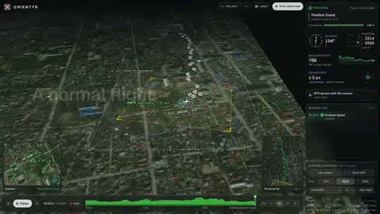

# Orientyr

Orientyr matches drone-camera frames to a satellite map to reconstruct the route without GPS.
Built for the Spectron hackathon.



Full presentation (3:14) is available locally in `data/orientyr_presentation.mp4`.

## Approach


RootSIFT matches each frame to cached map features. A MAGSAC++ homography estimates position, heading, and
the camera footprint. The Kalman tracker weights fixes by estimated uncertainty and predicts where to look
next. If the local search fails, the pipeline searches the whole map.

## Install

With Python 3.11+:

```bash
python3 -m venv .venv
source .venv/bin/activate
pip install -r requirements.txt && pip install -e .
```

## Data

Get the [challenge data](data/README.md) with `tools/data.sh setup` and `tools/data.sh pull hackatons-data`.

## Run and outputs

```bash
python scripts/run.py --map data/hackatons-data/global_map.png \
  --frames data/hackatons-data/crops --out outputs/run1
```

The run writes `trajectory.png`, `trajectory_preview.jpg`, `trajectory.mp4`, and telemetry in
`run.json` and `run.jsonl`.

## Results in numbers

**50 of 50 challenge frames localized.**

## Tests and repository layout

```bash
tools/task.sh test
```

See [NOTES.md](NOTES.md) for the full benchmarks, implementation details, and repository layout.
